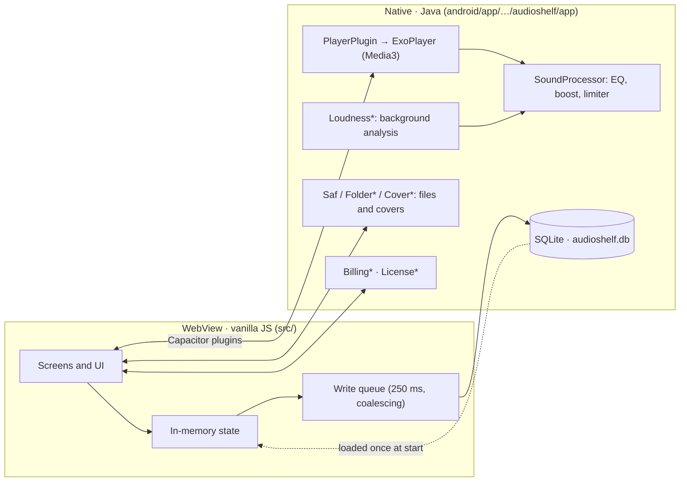

<div align="center">

# 🎧 AudioShelf

**A calm, private player for the audiobooks and music already on your phone.**

No accounts · No ads · No subscriptions · Works fully offline


-f7df1e?style=flat-square&logo=javascript&logoColor=black)

**English** · [Русский](README.ru.md)

</div>

---

## Contents

- [What it is](#what-it-is)
- [Features](#features)
- [Premium](#premium)
- [Supported formats](#supported-formats)
- [Project status](#project-status)
- [Architecture](#architecture)
- [How it works inside](#how-it-works-inside)
- [Repository layout](#repository-layout)
- [Getting started](#getting-started)
- [Tests](#tests)
- [CI and releases](#ci-and-releases)
- [Signing and updates](#signing-and-updates)
- [Versioning](#versioning)
- [Publishing to Google Play](#publishing-to-google-play)
- [Code principles](#code-principles)
- [Credits](#credits)

---

## What it is

AudioShelf plays the audio files you keep on your phone. You pick one folder; the app scans it with all subfolders, groups the files into **books** and **albums**, remembers your place in every one of them and keeps the battery in mind while it does so.

- Android app: **Capacitor 8** shell, UI in **vanilla JavaScript** (ES modules, built with **Vite 7**), native parts in **Java** on top of **Media3 ExoPlayer 1.8.0**.
- Package `com.audioshelf.app`, `minSdk 24` (Android 7.0), `targetSdk 36`.
- Interface languages: **English** and **Russian**. Themes: light (sand) and dark (AMOLED black).
- Your files are never modified and never leave the phone.

## Features

### Library

| | |
|---|---|
| **One folder** | Choose a folder through the system picker; access is limited to it (Storage Access Framework). |
| **Smart grouping** | A folder of chapters becomes a book, loose files become tracks and albums. Single-file books (`.m4b`) are detected on their own. `CD1`, `Disc 2`, `Part 3`, `Диск 1`… folders are merged into one book. |
| **Covers** | Taken from the files (embedded pictures, Matroska attachments), cached on disk. Without a cover a neat icon is shown: a closed book, an open book once you started listening, or a disc. |
| **Filter and search** | All / Books / Albums, search by title, author, narrator and year, several sorting orders, list and card views. |
| **Your own tags** | Title, author, narrator, year and type can be edited. Only the app's database changes, never the file. |
| **Progress at a glance** | A progress bar and state icon (new / started / finished) per book. |
| **Hide and restore** | Remove an item from the library without touching the file, bring it back from settings. |
| **Manual refresh** | The library is rescanned only when you ask for it. Scanning runs in the background and reports progress. |

### Player

| | |
|---|---|
| **Remembers everything** | Your place in every book; playback resumes 5 seconds earlier. Survives the system killing the app. |
| **Chapters** | Chapters inside one file are read from **MP3 (ID3 chapters)**, **M4B / MP4 (`chpl` atom)**, **QuickTime text-track chapters** and **Matroska (MKA)**; a chapter list is one tap away. |
| **Bookmarks** | Add a bookmark at any moment of a book. |
| **Whole-book progress** | Percentage and time left for the whole book, not only for the current file. |
| **Skip** | Back and forward steps of 5, 10, 15, 30 or 60 seconds (defaults: 15 back, 30 forward). |
| **Speed** | 0.75×, 1×, 1.25×, 1.5×, 1.75×, 2×. |
| **Sleep timer** | 15 / 30 / 45 / 60 minutes or end of the chapter. It counts only while sound is playing. |
| **Play modes** | Books: *continuous* or *pause after each chapter*. Albums: *in order*, *repeat all*, *repeat one*, *shuffle*. |
| **Fades** | Smooth fades between album tracks, instant switching between book chapters. |
| **System integration** | Media notification and lock screen controls with cover art; pauses when headphones are unplugged and during calls. For audiobooks a short foreign notification pauses playback instead of ducking it. |

### Sound

| | |
|---|---|
| **10-band equalizer** | 31 Hz … 16 kHz, a custom audio processor in the ExoPlayer chain. |
| **Presets** | Flat, Voice, Rock, Pop, Jazz, Classical, Electronic, Bass, Treble. |
| **Scopes** | One setting for everything, or a separate one for a chosen book or album. |
| **Volume boost** | 100 – 300 %, with a soft limiter against clipping. |
| **Loudness normalization** | Files are measured in the background (a 5-minute window from the middle of each file) and the gain is applied at playback to reach a common level (−16 dBFS RMS target, correction limited to ±12 dB). The files are not changed. |

### Power saving

- Normalization runs **automatically only on the charger** and stops by itself when the cable is removed, Battery Saver turns on or the battery gets low; the battery is checked every 5 seconds inside the decoding loop. A manual start also works without the charger.
- Optional **hardware (offload) playback**: the audio chip plays MP3 and AAC while the CPU sleeps. It is active only when the equalizer, boost and loudness trims are not in use and the speed is 1×. Settings show the real status: *not supported*, *on but not in effect*, or *on*.
- The interface repaints only what changed; the position is projected once a second from a native anchor and nothing ticks while paused or in the background.

## Premium

Everything is free except two features. **Premium is a one-time purchase, not a subscription** (Google Play Billing, product `premium`):

| Free | Premium |
|---|---|
| Library, search, tags, covers, chapters | Equalizer and presets |
| Player, bookmarks, sleep timer, speeds, modes | Per-book equalizer settings |
| Volume boost | Loudness normalization |
| Themes and languages | |

Three optional “buy the author a tea” tips (`tip_small`, `tip_medium`, `tip_large`) unlock nothing.

A **developer key** (Settings → Premium) turns Premium on for one specific phone: the app shows the device fingerprint, a key is issued for it with a separate tool (the local, git-ignored `AudioShelfLicense/` folder, never published) and checked offline by `DevLicense.java`.

## Supported formats

MP3, M4A, M4B, AAC, OGG, Opus, FLAC, WAV and any other format the phone's Android can play.

## Project status

**0.9.10 is a pre-test build.** The next planned version is **1.0.0**, cut right before testing.

What has been run automatically in a development sandbox: the production build, the 9 browser scenarios, the 22 JUnit tests of the pure Java classes, lint checks and syntax checks of Gradle and workflow files.

What has **not** been verified yet and is the point of the upcoming testing:

- a real Gradle build of the APK / AAB;
- behaviour on a physical phone: SQLite storage, cover loading, hardware offload, background normalization, notification controls, chapter handling;
- the CI test job on GitHub;
- real battery savings of offload playback.

Known open items: the R8 / minification is switched off in release builds, Premium is checked on the client only (no server verification), and the store screenshots in `store/screenshots/` are outdated.

## Architecture



## How it works inside

**Storage.** Everything the app remembers lives in one SQLite database `audioshelf.db` with a single table `kv (s TEXT, k TEXT, v TEXT, PRIMARY KEY (s, k)) WITHOUT ROWID` (WAL mode). At startup JavaScript loads all rows into memory once; reads come from memory. Writes go through a queue that merges identical keys, skips unchanged values and flushes in a single transaction 250 ms later, and also when the app is hidden. In a plain browser a `localStorage` fallback is used (development and tests).

**One table, many stores.** The store name is the first part of the key: book position `pos` (`{i, p, t}`, written often), book info `pinfo` (`{done, x, pc}`, written only when it changes), chapter durations `durs` (one row per chapter), the library cache `lib` (one row per file) and settings.

**Player state.** Native code pushes events; JavaScript projects the position and the sleep timer once a second from an anchor (`status-project`, `status-ticker`) and re-syncs with the native player every 10 seconds while playing. Nothing runs while paused or in the background. The position is remembered only on stop, on a jump, on a chapter change, when leaving for the library and when the app is hidden.

**Render only when needed.** The library list repaints when the data, the visible set or the view mode changes, or when you return to a tab that became stale. A progress change updates a single book's bar. The player view splits into a full paint and a cheap tick and does not paint while its tab is hidden.

**Loudness.** `Loudness*` decodes a 5-minute window from the middle of a file on a low-priority thread, computes the RMS level and stores one gain per file. The playback processor applies it together with the equalizer and the boost.

**Covers.** Extracted once, written to the app cache directory (at most 300 files) and shown through `Capacitor.convertFileSrc`, with an inline base64 fallback.

**Hardware playback.** `PlayerOffload` enables audio offload only when it is allowed in settings and the signal path is neutral; `OffloadSupport` asks `AudioManager.isOffloadedPlaybackSupported` for MP3 and AAC.

**Backup.** `allowBackup="false"`: the database is not uploaded to the cloud.

**Permissions.** `INTERNET` (billing), `FOREGROUND_SERVICE` + `FOREGROUND_SERVICE_MEDIA_PLAYBACK` (background playback), `POST_NOTIFICATIONS` (media notification), `WAKE_LOCK`. Audio files are reached only through the folder you pick.

## Repository layout

```text
src/                         web part (≈ 6 000 lines of JS and CSS, 200+ small files)
  main.js, start.js          entry point and initialisation order
  app/                       shell, router, system “Back”, swipes
  screens/                   library · player · sound · settings
  library/                   scanning, grouping, filter and search, covers, tags, hidden items
  player/                    state, progress, modes, chapters, bookmarks, status projection
  sound/                     equalizer, presets, boost, normalization
  billing/                   Premium, tips, lock, developer key
  settings/                  settings pages (swipeable)
  folder/                    JS wrappers of native plugins + browser mocks
  i18n/  theme/              languages (ru, en) and themes (light, dark)
  ui/  core/  styles/        small components, storage and DOM helpers, one CSS file per area
android/app/src/main/java/com/audioshelf/app/    77 Java classes, each ≤ 100 lines
  Player*, Playback*, Session*    ExoPlayer, media session, notification, resume
  Sound*, EqChain, Biquad, SoftLimiter    audio processing
  Loudness*, ExtractorAudio, BatteryWatch    background analysis
  AppDb, DbPlugin                SQLite storage
  Saf*, Folder*, Scan*, Cover*   folder access, scanning, covers
  *Chapters, Mp4Box, Ebml, Qt*   chapter readers (ID3, MP4, QuickTime, Matroska)
  Billing*, Purchase*, License*  Google Play Billing and developer key
tests/                       browser tests (Playwright) with mock plugins
android/app/src/test/        JUnit tests of pure Java classes
.github/workflows/           android.yml (test → build → release), release-aab.yml
store/                       Google Play listing, graphics, screenshots, publishing guide
docs/                        privacy policy (GitHub Pages)
```

## Getting started

Requirements: **Node 22+**, **Java 21**, Android Studio (or the Android SDK) for native builds.

```bash
npm ci                    # install dependencies
npm run dev               # run the UI in a browser with mock plugins
npm run sync              # build the web part and copy it into the Android project
npm run android           # open the project in Android Studio
cd android && ./gradlew assembleDebug
```

In the browser the native plugins are replaced by mocks, so the whole interface can be developed without a phone.

## Tests

| Command | What it runs |
|---|---|
| `npm test` | Builds the app and runs 9 browser scenarios with Playwright against the production build: play / pause, book modes, player tick, write splitting, library progress, chapters, settings pages, auto-normalization, boost and power saving. Run `npx playwright install chromium` once. |
| `cd android && ./gradlew testDebugUnitTest` | 22 JUnit tests for pure Java classes: license key, equalizer chain, soft limiter, loudness statistics, QuickTime tables. |

## CI and releases

`.github/workflows/android.yml` (Node 22, Java 21, the Capacitor 8 requirement):

1. **test**: `npm ci`, `npm test`, `./gradlew testDebugUnitTest`.
2. **build**: only after the tests pass; restores the signing key from secrets, builds the debug APK `AudioShelf-<version>.apk` and uploads it to Artifacts.
3. **release**: a separate job that publishes the release **“AudioShelf <version>”** (tag `v<version>`) with the APK. It is the only job with write access, and it does not run for pull requests.

The workflow runs with read-only permissions by default. `release-aab.yml` is a manual build of a signed AAB for Google Play.

## Signing and updates

An Android phone installs a new APK over an old one only if both are signed with **the same key**. The repository is public, so the key is **not** in it: it is stored in four GitHub secrets (`AUDIOSHELF_DEBUG_*`), and the workflow restores it for the duration of the build. Without the secrets (for example, a fork) the build still succeeds but is signed with a temporary Android debug key, and such an APK will not install over one signed with the real key. Google Play uses a separate upload key. Step-by-step instructions: [`store/PUBLISHING.md`](store/PUBLISHING.md).

Keep the keystore file and its passwords outside the repository and in at least two safe places: a lost key means the app has to be uninstalled and installed again.

## Versioning

The version lives in one place: **`package.json` → `version`**. From it come the text in settings, `versionName`, `versionCode`, the APK name and the release title.

```text
versionCode = major × 10000 + minor × 100 + patch
0.9.10 → 910      0.2.0 → 200      1.0.0 → 10000
```

To ship an update: raise the version and push. Pushing without changing it replaces the APK of that release.

## Publishing to Google Play

Everything is prepared; the step-by-step guide is [`store/PUBLISHING.md`](store/PUBLISHING.md).

- `store/listing/` · texts for the store page (RU, EN)
- `store/graphics/` · icon and feature graphic
- `store/screenshots/` · screenshots (to be refreshed)
- `store/data-safety.md` · answers for Data safety and declarations
- `docs/index.html` · privacy policy (enable GitHub Pages from `/docs` and fill in the contact e-mail)

## Code principles

- **Atomicity.** One file, one responsibility. Small modules; a Java file never exceeds 100 lines.
- **Do only what is needed.** Write only what changed, read only when needed, repaint only what was touched.
- **Screens are registered in one place**, `src/screens/index.js`: tabs and the header are built from it.
- **No comments in the code.** Names and structure carry the meaning; the reasoning lives in `CHANGELOG.md`.
- **No system dialogs.** The app uses its own dialogs and sheets.

The full history of changes is in [`CHANGELOG.md`](CHANGELOG.md).

## Credits

- Emoji artwork: [Noto Emoji](https://github.com/googlefonts/noto-emoji) by Google (Apache License 2.0), extracted via svgmoji (MIT).
- Built with [Capacitor](https://capacitorjs.com/), [Vite](https://vitejs.dev/), [AndroidX Media3](https://developer.android.com/media/media3) and [Playwright](https://playwright.dev/).
