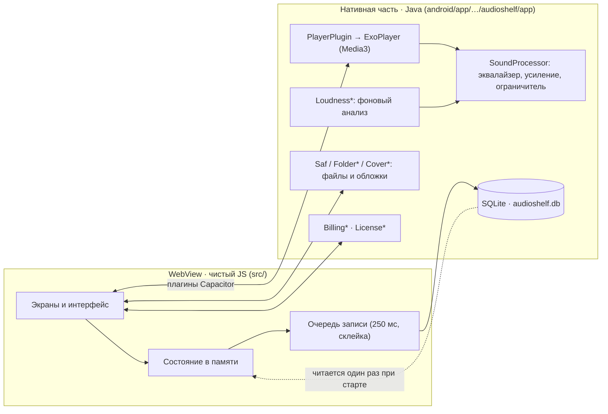

<div align="center">

# 🎧 AudioShelf

**Спокойный и приватный плеер для аудиокниг и музыки, которые уже лежат у вас на телефоне.**

Без аккаунтов · Без рекламы · Без подписок · Работает полностью офлайн


-f7df1e?style=flat-square&logo=javascript&logoColor=black)

[English](README.md) · **Русский**

</div>

---

## Содержание

- [Что это](#что-это)
- [Возможности](#возможности)
- [Премиум](#премиум)
- [Поддерживаемые форматы](#поддерживаемые-форматы)
- [Состояние проекта](#состояние-проекта)
- [Архитектура](#архитектура)
- [Как это устроено внутри](#как-это-устроено-внутри)
- [Структура репозитория](#структура-репозитория)
- [Быстрый старт](#быстрый-старт)
- [Тесты](#тесты)
- [CI и релизы](#ci-и-релизы)
- [Подпись и обновления](#подпись-и-обновления)
- [Версии](#версии)
- [Публикация в Google Play](#публикация-в-google-play)
- [Принципы кода](#принципы-кода)
- [Благодарности](#благодарности)

---

## Что это

AudioShelf проигрывает аудиофайлы, которые вы храните на телефоне. Вы выбираете одну папку, приложение обходит её со всеми подпапками, раскладывает файлы на **книги** и **альбомы**, помнит место в каждой из них и бережёт батарею.

- Приложение для Android: оболочка **Capacitor 8**, интерфейс на **чистом JavaScript** (ES-модули, сборка **Vite 7**), нативная часть на **Java** поверх **Media3 ExoPlayer 1.8.0**.
- Пакет `com.audioshelf.app`, `minSdk 24` (Android 7.0), `targetSdk 36`.
- Языки интерфейса: **русский** и **английский**. Темы: светлая (песочная) и тёмная (чёрный AMOLED).
- Файлы не изменяются и не покидают телефон.

## Возможности

### Библиотека

| | |
|---|---|
| **Одна папка** | Папка выбирается системным окном, доступ ограничен только ею (Storage Access Framework). |
| **Умная раскладка** | Папка с главами становится книгой, одиночные файлы — треками и альбомами. Книги в одном файле (`.m4b`) распознаются сами. Папки `CD1`, `Disc 2`, `Part 3`, `Диск 1` склеиваются в одну книгу. |
| **Обложки** | Берутся из файлов (встроенные картинки, вложения Matroska) и кэшируются на диске. Если обложки нет, показывается аккуратный значок: закрытая книга, открытая книга после начала прослушивания или диск. |
| **Фильтр и поиск** | «Все / Книги / Альбомы», поиск по названию, автору, чтецу и году, несколько видов сортировки, вид списком и карточками. |
| **Свои теги** | Название, автора, чтеца, год и тип можно поправить. Меняется только база приложения, файл остаётся нетронутым. |
| **Прогресс на виду** | У каждой книги полоска прогресса и значок состояния: новая, начата, прослушана. |
| **Скрыть и вернуть** | Убрать позицию из библиотеки, не трогая файл, и вернуть её в настройках. |
| **Обновление вручную** | Библиотека пересканируется только по вашей кнопке. Сканирование идёт в фоне и показывает ход работы. |

### Плеер

| | |
|---|---|
| **Помнит всё** | Место в каждой книге, запуск с откатом на 5 секунд. Переживает убийство приложения системой. |
| **Главы** | Главы внутри одного файла читаются из **MP3 (главы ID3)**, **M4B / MP4 (атом `chpl`)**, **текстовой дорожки QuickTime** и **Matroska (MKA)**. Список глав открывается одним нажатием. |
| **Закладки** | Закладка в любом месте книги. |
| **Прогресс всей книги** | Процент и оставшееся время для всей книги, а не только для текущего файла. |
| **Перемотка** | Шаг назад и вперёд на 5, 10, 15, 30 или 60 секунд (по умолчанию 15 назад и 30 вперёд). |
| **Скорость** | 0,75×, 1×, 1,25×, 1,5×, 1,75×, 2×. |
| **Таймер сна** | 15 / 30 / 45 / 60 минут или конец главы. Считает только пока играет звук. |
| **Режимы** | Книги: *подряд* или *пауза после каждой главы*. Альбомы: *по порядку*, *повтор всех*, *повтор трека*, *вперемешку*. |
| **Переходы** | Плавное появление и затухание между треками альбома, мгновенный переход между главами книги. |
| **Интеграция с системой** | Шторка уведомлений и экран блокировки с обложкой; пауза при отключении наушников и во время звонка. Для аудиокниг короткое чужое уведомление ставит воспроизведение на паузу, а не приглушает его. |

### Звук

| | |
|---|---|
| **10-полосный эквалайзер** | От 31 Гц до 16 кГц, собственный аудиопроцессор в цепочке ExoPlayer. |
| **Пресеты** | Плоский, Голос, Рок, Поп, Джаз, Классика, Электроника, Бас, Высокие. |
| **Область действия** | Одна настройка на всё или отдельная для выбранной книги или альбома. |
| **Усиление** | 100 – 300 % с мягким ограничителем против перегрузки. |
| **Нормализация громкости** | Файлы измеряются в фоне (5 минут из середины каждого файла), а при воспроизведении применяется поправка до общего уровня (цель −16 dBFS по RMS, поправка не больше ±12 дБ). Сами файлы не меняются. |

### Экономия энергии

- Нормализация запускается **автоматически только на зарядке** и сама останавливается, когда вынули кабель, включилась экономия батареи или заряд упал. Состояние батареи проверяется каждые 5 секунд прямо в цикле декодирования. Ручной запуск работает и без зарядки.
- Необязательное **аппаратное воспроизведение (offload)**: звук для MP3 и AAC играет аудиочип, а процессор спит. Оно действует, только когда не используются эквалайзер, усиление и поправки громкости, а скорость равна 1×. В настройках виден настоящий статус: *не поддерживается*, *включено, но сейчас не действует* или *включено*.
- Интерфейс перерисовывает только изменившееся. Позиция раз в секунду вычисляется от нативной точки отсчёта, а на паузе и в фоне ничего не тикает.

## Премиум

Бесплатно всё, кроме двух функций. **Премиум — разовая покупка, а не подписка** (Google Play Billing, товар `premium`):

| Бесплатно | Премиум |
|---|---|
| Библиотека, поиск, теги, обложки, главы | Эквалайзер и пресеты |
| Плеер, закладки, таймер сна, скорости, режимы | Отдельные настройки эквалайзера для книги |
| Усиление | Нормализация громкости |
| Темы и языки | |

Три необязательных «чаевых» (`tip_small`, `tip_medium`, `tip_large`) ничего не открывают.

**Ключ разработчика** (Настройки → Премиум) включает Премиум на одном конкретном телефоне: приложение показывает отпечаток устройства, под него отдельным инструментом (локальная папка `AudioShelfLicense/`, она в `.gitignore` и не публикуется) выдаётся ключ, а проверяет его без сети `DevLicense.java`.

## Поддерживаемые форматы

MP3, M4A, M4B, AAC, OGG, Opus, FLAC, WAV и любые другие форматы, которые умеет играть Android на телефоне.

## Состояние проекта

**0.9.10 — предтестовая сборка.** Следующая запланированная версия — **1.0.0**, её выпустим непосредственно перед тестированием.

Что уже прогонялось автоматически в среде разработки: рабочая сборка, 9 браузерных сценариев, 22 JUnit-теста чистых Java-классов, проверки линтером и проверка синтаксиса Gradle-файлов и workflow.

Что **ещё не проверено** и составляет предмет предстоящего тестирования:

- настоящая сборка APK / AAB через Gradle;
- поведение на реальном телефоне: хранилище SQLite, загрузка обложек, аппаратный offload, фоновая нормализация, управление из уведомления, главы;
- тестовая задача CI на GitHub;
- реальная экономия батареи при аппаратном воспроизведении.

Известные открытые вопросы: R8 / минификация в релизной сборке выключена, Премиум проверяется только на стороне клиента (серверной проверки нет), а скриншоты в `store/screenshots/` устарели.

## Архитектура



## Как это устроено внутри

**Хранение.** Всё, что помнит приложение, лежит в одной базе SQLite `audioshelf.db` с единственной таблицей `kv (s TEXT, k TEXT, v TEXT, PRIMARY KEY (s, k)) WITHOUT ROWID` (режим WAL). При запуске JavaScript один раз читает все строки в память, дальше чтение идёт из памяти. Запись проходит через очередь: одинаковые ключи склеиваются, неизменившиеся значения пропускаются, а сброс идёт одной транзакцией через 250 мс и при сворачивании приложения. В обычном браузере работает запасной вариант на `localStorage` (разработка и тесты).

**Одна таблица, много хранилищ.** Имя хранилища — первая часть ключа: позиция книги `pos` (`{i, p, t}`, пишется часто), сведения о книге `pinfo` (`{done, x, pc}`, пишутся только при изменении), длительности глав `durs` (строка на главу), кэш библиотеки `lib` (строка на файл) и настройки.

**Состояние плеера.** Нативный код присылает события, а JavaScript раз в секунду вычисляет позицию и таймер сна от точки отсчёта (`status-project`, `status-ticker`) и сверяется с нативным плеером каждые 10 секунд, пока играет звук. На паузе и в фоне ничего не работает. Позиция запоминается только при остановке, перемотке, смене главы, уходе в библиотеку и сворачивании приложения.

**Перерисовка только по необходимости.** Список библиотеки перерисовывается при изменении данных, набора на экране или вида, а также при возвращении на вкладку, которая успела устареть. Изменение прогресса обновляет полоску одной книги. Экран плеера делится на полную отрисовку и дешёвый тик и не рисуется, пока вкладка скрыта.

**Громкость.** `Loudness*` декодирует 5 минут из середины файла в потоке с низким приоритетом, считает уровень RMS и сохраняет одну поправку на файл. Процессор воспроизведения применяет её вместе с эквалайзером и усилением.

**Обложки.** Извлекаются один раз, пишутся в кэш приложения (не больше 300 файлов) и показываются через `Capacitor.convertFileSrc`, с запасным вариантом в виде base64 прямо в разметке.

**Аппаратное воспроизведение.** `PlayerOffload` включает аппаратный режим, только когда он разрешён в настройках, а тракт звука нейтральный; `OffloadSupport` спрашивает у `AudioManager.isOffloadedPlaybackSupported` про MP3 и AAC.

**Резервные копии.** `allowBackup="false"`: база не уходит в облако.

**Разрешения.** `INTERNET` (покупки), `FOREGROUND_SERVICE` и `FOREGROUND_SERVICE_MEDIA_PLAYBACK` (фоновое воспроизведение), `POST_NOTIFICATIONS` (уведомление плеера), `WAKE_LOCK`. К аудиофайлам доступ есть только через выбранную вами папку.

## Структура репозитория

```text
src/                         веб-часть (≈ 6 000 строк JS и CSS, 200+ небольших файлов)
  main.js, start.js          точка входа и порядок инициализации
  app/                       оболочка, роутер, системная «Назад», свайпы
  screens/                   библиотека · плеер · звук · настройки
  library/                   сканирование, раскладка, фильтр и поиск, обложки, теги, скрытые позиции
  player/                    состояние, прогресс, режимы, главы, закладки, проекция статуса
  sound/                     эквалайзер, пресеты, усиление, нормализация
  billing/                   Премиум, чаевые, замок, ключ разработчика
  settings/                  страницы настроек (листаются свайпом)
  folder/                    JS-обёртки нативных плагинов + заглушки для браузера
  i18n/  theme/              языки (ru, en) и темы (светлая, тёмная)
  ui/  core/  styles/        мелкие компоненты, хранилище и помощники DOM, по одному CSS-файлу на область
android/app/src/main/java/com/audioshelf/app/    77 Java-классов, каждый ≤ 100 строк
  Player*, Playback*, Session*    ExoPlayer, медиасессия, уведомление, возобновление
  Sound*, EqChain, Biquad, SoftLimiter    обработка звука
  Loudness*, ExtractorAudio, BatteryWatch    фоновый анализ
  AppDb, DbPlugin                хранилище SQLite
  Saf*, Folder*, Scan*, Cover*   доступ к папке, сканирование, обложки
  *Chapters, Mp4Box, Ebml, Qt*   чтение глав (ID3, MP4, QuickTime, Matroska)
  Billing*, Purchase*, License*  Google Play Billing и ключ разработчика
tests/                       браузерные тесты (Playwright) с заглушками плагинов
android/app/src/test/        JUnit-тесты чистых Java-классов
.github/workflows/           android.yml (тесты → сборка → релиз), release-aab.yml
store/                       карточка Google Play, графика, скриншоты, инструкция по публикации
docs/                        политика конфиденциальности (GitHub Pages)
```

## Быстрый старт

Нужны: **Node 22+**, **Java 21**, Android Studio (или Android SDK) для нативной сборки.

```bash
npm ci                    # установить зависимости
npm run dev               # запустить интерфейс в браузере с заглушками плагинов
npm run sync              # собрать веб-часть и скопировать её в Android-проект
npm run android           # открыть проект в Android Studio
cd android && ./gradlew assembleDebug
```

В браузере нативные плагины заменены заглушками, поэтому весь интерфейс можно разрабатывать без телефона.

## Тесты

| Команда | Что запускает |
|---|---|
| `npm test` | Собирает приложение и прогоняет 9 браузерных сценариев Playwright на рабочей сборке: пуск и пауза, режимы книги, тик плеера, разделение записи, прогресс в библиотеке, главы, страницы настроек, автонормализация, усиление и экономия энергии. Один раз нужно выполнить `npx playwright install chromium`. |
| `cd android && ./gradlew testDebugUnitTest` | 22 JUnit-теста чистых Java-классов: лицензионный ключ, цепочка эквалайзера, мягкий ограничитель, статистика громкости, таблицы QuickTime. |

## CI и релизы

`.github/workflows/android.yml` (Node 22, Java 21: этого требует Capacitor 8):

1. **test**: `npm ci`, `npm test`, `./gradlew testDebugUnitTest`.
2. **build**: только после успешных тестов; восстанавливает ключ подписи из секретов, собирает debug-APK `AudioShelf-<версия>.apk` и кладёт его в Artifacts.
3. **release**: отдельная задача, публикует релиз **«AudioShelf <версия>»** (тег `v<версия>`) с этим APK. Только у неё есть право записи, и для pull request она не запускается.

По умолчанию workflow работает с правами только на чтение. `release-aab.yml` — ручная сборка подписанного AAB для Google Play.

## Подпись и обновления

Android ставит новый APK поверх старого, только если оба подписаны **одним и тем же ключом**. Репозиторий публичный, поэтому ключа в нём **нет**: он хранится в четырёх секретах GitHub (`AUDIOSHELF_DEBUG_*`), а workflow восстанавливает его на время сборки. Без секретов (например, в чужом форке) сборка всё равно проходит, но подписывается временным debug-ключом Android, и такой APK не встанет поверх APK с настоящим ключом. Для Google Play используется отдельный ключ загрузки. Пошаговая инструкция: [`store/PUBLISHING.md`](store/PUBLISHING.md).

Файл ключа и пароли храните вне репозитория и минимум в двух надёжных местах: потеряете ключ, и приложение придётся удалить и поставить заново.

## Версии

Версия задаётся в одном месте: **`package.json` → `version`**. Из неё берутся текст в настройках, `versionName`, `versionCode`, имя APK и название релиза.

```text
versionCode = major × 10000 + minor × 100 + patch
0.9.10 → 910      0.2.0 → 200      1.0.0 → 10000
```

Чтобы выпустить обновление, поднимите версию и запушьте. Если версию не менять, APK релиза с этим номером будет заменён новым.

## Публикация в Google Play

Всё подготовлено, пошаговая инструкция: [`store/PUBLISHING.md`](store/PUBLISHING.md).

- `store/listing/` · тексты карточки (RU, EN)
- `store/graphics/` · иконка и feature graphic
- `store/screenshots/` · скриншоты (нужно обновить)
- `store/data-safety.md` · ответы для Data safety и деклараций
- `docs/index.html` · политика конфиденциальности (включите GitHub Pages из `/docs` и впишите e-mail)

## Принципы кода

- **Атомарность.** Один файл, одна ответственность. Модули маленькие, Java-файл не длиннее 100 строк.
- **Делаем только нужное.** Пишем только изменившееся, читаем только когда нужно, перерисовываем только то, что затронуто.
- **Экраны регистрируются в одном месте**, `src/screens/index.js`: вкладки и заголовок строятся из него.
- **Без комментариев в коде.** Смысл несут имена и структура, а объяснения решений лежат в `CHANGELOG.md`.
- **Никаких системных диалогов.** Приложение использует собственные окна и шторки.

Полная история изменений: [`CHANGELOG.md`](CHANGELOG.md).

## Благодарности

- Рисунки эмодзи: [Noto Emoji](https://github.com/googlefonts/noto-emoji) от Google (Apache License 2.0), извлечены через svgmoji (MIT).
- Собрано на [Capacitor](https://capacitorjs.com/), [Vite](https://vitejs.dev/), [AndroidX Media3](https://developer.android.com/media/media3) и [Playwright](https://playwright.dev/).
